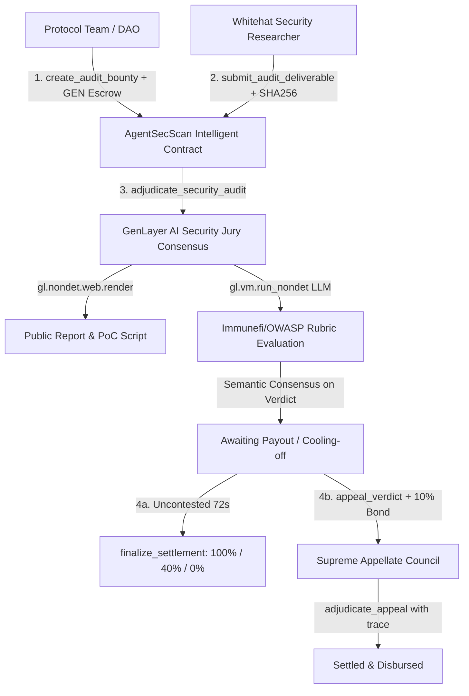

# AgentSecScan Technical Architecture

**Autonomous Smart Contract Security Audit Escrow & Vulnerability Disclosure Court on GenLayer**

---

## 1. System Overview

AgentSecScan is an autonomous, decentralized security escrow and adjudication protocol running on **GenLayer Studionet** (Chain ID: `61999`). It solves the fundamental dilemma of Bug Bounty programs and security audits in Web3:
- **Protocol Dilemma**: Protocols risk paying for spam, fake PoCs, or unverified vulnerabilities.
- **Auditor Dilemma**: Whitehat researchers risk protocols stealing their disclosure, downplaying severity (e.g., Critical $\rightarrow$ Informational), or refusing to pay.
- **EVM Limitation**: Traditional EVM blockchains are deterministic state machines incapable of reading GitHub repositories, verifying SHA-256 deliverable commitments, running test frameworks (Foundry/Hardhat), or evaluating AST exploitability.

By leveraging GenLayer's **Intelligent Contracts**, AgentSecScan brings code analysis, PoC reproducibility testing, and impartial dispute resolution directly on-chain.



---

## 2. Core Intelligent Contract State Machine

The contract implements a 9-state formal lifecycle:

| State ID | Enum Status | Description |
|---|---|---|
| `0` | `STATUS_BOUNTY_OPEN` | Escrow funded by protocol; open for whitehat submissions. |
| `1` | `STATUS_REPORT_SUBMITTED` | Deliverable submitted with SHA-256 commitment; awaiting AI Jury. |
| `2` | `STATUS_AWAITING_PAYOUT` | Verdict rendered; 24-block (~72s) dispute cooling-off window active. |
| `3` | `STATUS_SETTLED_PAID_FULL` | Critical/High flaw verified; 100% bounty disbursed to researcher. |
| `4` | `STATUS_SETTLED_PARTIAL` | Medium/Low flaw verified; 40% to researcher, 60% refunded to protocol. |
| `5` | `STATUS_SETTLED_REJECTED` | Invalid/Spam PoC rejected; 100% refunded to protocol team. |
| `6` | `STATUS_DISPUTED` | Appealed within cooling-off window with 10% staked bond. |
| `7` | `STATUS_CANCELLED` | Expired without deliverables; 100% escrow reclaimed by protocol. |
| `8` | `STATUS_UNRESOLVED` | Non-settling protected state on network or commitment failure. |

---

## 3. Cryptographic & Security Mechanisms

### 3.1 Content Commitment Hash (Anti-Tampering)
Upon submitting a report, the whitehat commits a 64-character hex SHA-256 hash `report_evidence_hash`. During consensus:
```python
computed_hash = hashlib.sha256(raw_report.encode("utf-8")).hexdigest()
if computed_hash != expected_hash:
    return {
        "canary": CANARY_TOKEN,
        "verdict": "UNRESOLVED_COMMITMENT_FAILED",
        "reason": "Report SHA-256 content commitment mismatch.",
    }
```
If the report URL contents are altered post-submission, consensus immediately aborts to `STATUS_UNRESOLVED`, preventing fraudulent bait-and-switch.

### 3.2 Security Canary Defense
All prompts enforce a secret canary token (`CANARY_AGENT_SEC_SCAN_V1`). The leader and validator nodes check:
```python
if str(parsed.get("canary", "")) != CANARY_TOKEN:
    return {"verdict": "UNRESOLVED_CANARY_FAILED"}
```
This neutralizes prompt injection payloads attempted within the untrusted security disclosures.

### 3.3 Semantic Consensus on Meaning (Not Shape)
Unlike naive contracts that use strict string equality on free-form JSON outputs, AgentSecScan uses `gl.vm.run_nondet(leader_fn, validator_fn)`:
```python
def validator_fn(leader_res) -> bool:
    if not isinstance(leader_res, gl.vm.Return):
        return False
    leader = leader_res.calldata
    mine = leader_fn()
    return mine["verdict"] == leader["verdict"]
```
Validators agree if the core security determination matches (`VULNERABILITY_CONFIRMED_FULL`, `PARTIAL_SEVERITY_PAYOUT`, `CLAIM_REJECTED_INVALID`), preventing consensus stall from subtle phrasing differences in rationale text.

### 3.4 24-Block Dispute Window & Appellate Court
During the 24-block (~72 second) cooling-off period:
- Either the protocol team or the researcher may appeal by staking a **10% dispute bond**.
- The appellant must submit a bound supplemental execution trace (e.g. Foundry debug log).
- The Supreme Security Council re-evaluates the case against the execution trace.
- If upheld, the bond is refunded and the payout is adjusted; if dismissed, the bond is forfeited to the counterparty.

### 3.5 Pull-Payment Safe Transfer Pattern
To prevent lost funds and avoid re-entrancy, disbursements use `_safe_transfer`:
```python
def _safe_transfer(self, recipient: Address, amount: bigint) -> None:
    if amount <= bigint(0):
        return
    rec_str = _addr_str(recipient)
    try:
        gl.get_contract_at(recipient).emit_transfer(value=u256(int(amount)))
    except Exception:
        curr = self.claimable_balances.get(rec_str, bigint(0))
        self.claimable_balances[rec_str] = curr + amount
```
Any failed native transfer is buffered in `claimable_balances` and can be claimed anytime via `claim_payout()`.

---

## 4. Deployed Network & Verification

- **Network**: GenLayer Studionet (Chain ID: `61999`, Hex `0xF22F`)
- **RPC Endpoint**: `https://studio.genlayer.com/api`
- **Contract Address**: `0xe991eb664f0e4551545929600b8cfe0Fc8EB9941`
- **Deployment Transaction**: `0xa9f5c6df4afdeb272273d6eb9210aca520d99059d24866d5e980ab61808bf5d0`
- **Receipt Status**: `SUCCESS`
